<div align="center">
  
</div>

<div align="center">

[](https://www.timtulang.me)&nbsp;
[](mailto:tulangtimothy@gmail.com)&nbsp;
[](https://www.linkedin.com/in/tim-tulang-211a26293/)

</div>


```text
$ whoami
tulang_timothy_john

$ cat about.txt
Third-year Computer Science at PLM.
I build things, and I study how machines learn.
Quiet by default. Ships anyway.
```


<div align="center">
  
</div>


<div align="center">
  
</div>

<div align="center">
  
</div>
